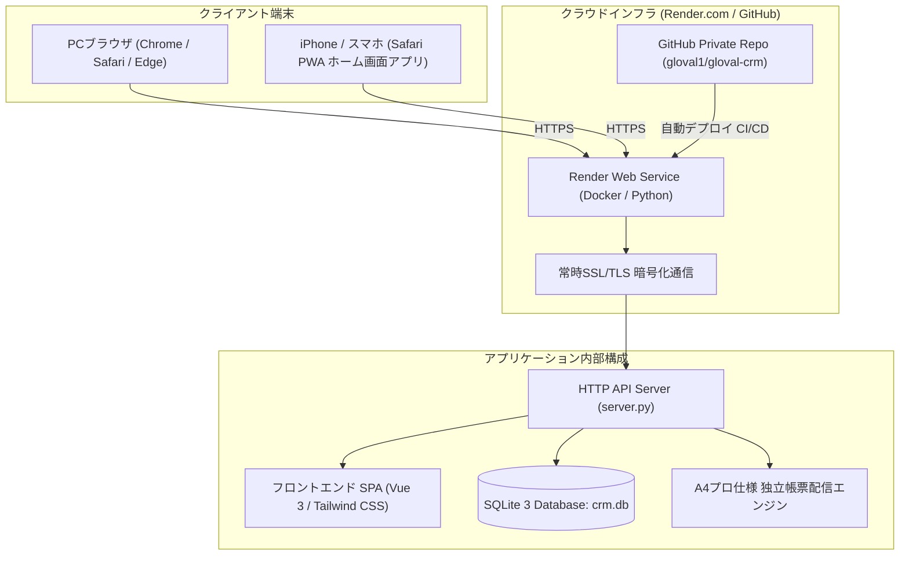
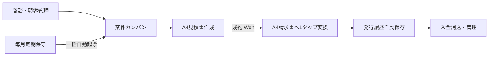

# 株式会社GLOVAL 営業SFA/CRMシステム 要件定義書

**文書番号:** GLOVAL-SFA-REQ-202611  
**初版作成日:** 2026年11月17日  
**対象システム:** GLOVAL SFA & CRM プラットフォーム  
**対象組織:** 株式会社GLOVAL  

---

## 1. システム概要と開発目的

### 1.1 背景と課題
株式会社GLOVALにおける少人数精鋭（役員・営業メンバー3名体制）の機動的な営業活動において、以下の課題を解決することを目的とする。
* 外出先や移動中のスマートフォンから、案件進捗・顧客情報をリアルタイムに確認・更新したい。
* 商談成立後、見積書から請求書への転記や作成の手間を削減し、現場から1タップで即時発行したい。
* 印刷時やPDF保存時にレイアウト崩れが発生せず、インボイス制度・公式角印・振込口座が完璧に反映されたA4ジャスト1枚の公式帳票を出力したい。
* 月額保守や定期顧問料などのサブスク型案件の請求起票漏れ・請求遅延をゼロにしたい。
* PCのスリープや電源状態に依存せず、24時間365日常時稼働する固定URLでアクセスしたい。

### 1.2 システムの目的
本システム（GLOVAL CRM）は、**「商談獲得 ➔ 進捗管理 ➔ 見積作成 ➔ 受注(Won) ➔ 請求書発行 ➔ 定期請求自動化 ➔ 入金消込」** の全営業サイクルを、PCおよびスマートフォン（iPhone/Android）から完全一元管理できる専用Webアプリケーションである。

---

## 2. システム構成・運用環境



### 2.1 稼働環境仕様
| 項目 | 仕様 |
| :--- | :--- |
| **本番クラウド環境** | Render.com Web Service (Docker Container, Python 3.9) |
| **本番URL** | `https://gloval-crm.onrender.com` (SSL/TLS常時暗号化) |
| **ソースコード管理** | GitHub (`https://github.com/gloval1/gloval-crm`) |
| **ローカル待機環境** | macOS / Python 3.9+ / ポート 8088 |
| **データベース** | SQLite 3 (`crm.db` / 軽量・高速・トランザクション保証) |
| **クライアント要件** | iOS 15+ (Safari / PWA対応), macOS / Windows (モダンブラウザ) |

---

## 3. 利用者・組織定義

本システムは株式会社GLOVALのフラットな営業体制に最適化された権限構成を持つ。

| ユーザーID | 氏名 | 役職/役割 | メールアドレス | テーマカラー |
| :---: | :--- | :--- | :--- | :---: |
| **1** | **黒川 剛** | 営業担当 / メンバー | `kurokawa@gloval.com` | `#4f46e5` (Indigo) |
| **2** | **奥中 佑亮** | 営業担当 / メンバー | `okunaka@gloval.com` | `#06b6d4` (Cyan) |
| **3** | **屋木 孝之** | 営業担当 / メンバー | `yaki@gloval.com` | `#10b981` (Emerald) |

---

## 4. 機能要件一覧



### 4.1 認証・セキュリティ要件
* **F-01: 合言葉（パスフレーズ）認証**
  * システム全体を「合言葉」によって保護。初期設定値および環境変数 `CRM_PASSWORD` による固定化に対応。
  * 認証トークンはブラウザの `localStorage` または `sessionStorage` に安全に保持され、再アクセス時の入力を省略。
  * 設定メニューより合言葉の変更が可能。

### 4.2 商談・パイプライン管理要件
* **F-02: カンバン進捗管理（ドラッグ＆ドロップ）**
  * ステージ構成: 
    1. リード獲得 (`lead` / 確度 10%)
    2. 初回面談 (`meeting` / 確度 30%)
    3. 提案・見積提出 (`proposal` / 確度 60%)
    4. 最終条件交渉 (`negotiation` / 確度 80%)
    5. 受注・成約 (`won` / 確度 100%)
    6. 失注 (`lost` / 確度 0%)
  * マウスドラッグまたはスマホでのドロップダウン選択によりステージを瞬時に更新。
* **F-03: 商談詳細・属性管理**
  * 案件名、取引先企業、営業担当者、想定金額、完了予定日、失注理由、特記事項。
  * スマートフォン表示用に「全体」「各ステージ」を1タップで絞り込めるピルフィルターを常設。

### 4.3 帳票発行システム（見積書・請求書）要件
* **F-04: プロ仕様A4ジャスト1枚出力（独立配信方式）**
  * モーダルやCSSフレームワークの干渉を100%排除した独立エンドポイント（`/api/print/document`）による配信。
  * PC・スマートフォン（iOS Safari）のどちらからでも、印刷プレビュー時に改ページや文字切れ・余白の崩れが一切発生せず、A4用紙ジャスト1枚に収まる設計。
* **F-05: 法的・企業記載事項の完全準拠**
  * **適格請求書発行事業者登録番号:** `T8120001265886`
  * **発行元企業情報:**  
    株式会社GLOVAL  
    〒540-0021 大阪府大阪市中央区大手通2-4-8
  * **公式角印:** 高解像度角印画像をBase64方式で帳票内に完全自動押印。
  * **振込指定口座:**  
    GMOあおぞらネット銀行 フリー支店 (普通) 1219666  
    口座名義：カ）グローヴァル
* **F-06: 動的内訳計算**
  * 品名、数量、単位（式・個・月等）、単価の複数行追加・削除に対応。
  * 小計、消費税（10%標準税率）、総合計金額をリアルタイム自動計算。
* **F-07: 客先送信用メッセージ（LINE・メール文面）自動生成**
  * 見積・請求書の内容から、クライアントへそのまま送れる丁寧な送信文面をワンタップで自動作成。
  * 「文面をコピー」「LINEで送る」ボタンを完備。

### 4.4 発行履歴・変換・自動化要件
* **F-08: 見積書・請求書の発行履歴（自動アーカイブ保存 & 復元）**
  * 帳票の印刷またはPDF保存時に、当時の宛先・金額・内訳明細・備考・発行番号を自動でデータベースへアーカイブ保存。
  * モーダル内の「📁 発行履歴」一覧から、過去の書類内容を1タップで完全に画面上へ復元・再出力可能。
* **F-09: 見積書 ➔ 受注(Won) ➔ ワンタップ請求書変換**
  * 見積書プレビュー画面から「🤝 成約にして請求書を作成」ボタンを押下することで、商談を「成約(Won)」に更新し（祝福アニメーション実行）、見積内容を全て引き継いだ請求書（INVOICE）を即座に起票。
* **F-10: 毎月の定期請求・サブスク（月額保守）の一括自動起票**
  * 案件ごとに「🔄 毎月の定期請求（月額保守など）」フラグおよび請求起票日（例: 毎月25日）を設定可能。
  * パイプライン画面上部の「🔄 今月の定期請求を一括起票」ボタンにより、当月度の請求案件（例: `〇〇保守 (2026年11月度)`）を一瞬で一括自動生成し、二重起票を防止。

### 4.5 請求・入金消込管理要件
* **F-11: 3段階請求ステータス管理**
  * 未請求 (`unbilled`) ➔ 請求済 (`billed`) ➔ 入金完了 (`paid`)
  * ダッシュボードおよび案件詳細より、請求日・入金日・ステータスを即時更新。

### 4.6 PWA・モバイル最適化要件
* **F-12: ホーム画面専用アプリ化（PWA対応）**
  * `manifest.json` および iOS Safari専用 `apple-touch-icon` を完備。
  * 公式ロゴ（ダークネイビー背景＋ゴールド「G」モノグラム＋「GLOVAL SFA & CRM」ロゴ）による512×512高精細アプリアイコン。
  * iPhoneの「ホーム画面に追加」を実行することで、Safariのアドレスバーやナビゲーションのない全画面専用ネイティブアプリとして起動。

---

## 5. データベース設計（論理ER仕様）

### 5.1 主要テーブル定義

#### 1. `users`（担当メンバー）
| カラム名 | 型 | 制約 | 説明 |
| :--- | :--- | :--- | :--- |
| `id` | INTEGER | PRIMARY KEY | ユーザーID (1:黒川, 2:奥中, 3:屋木) |
| `name` | TEXT | NOT NULL | 氏名 |
| `email` | TEXT | UNIQUE | メールアドレス |
| `role` | TEXT | DEFAULT 'member' | 権限 |
| `avatar_color` | TEXT | | アバター表示色 |
| `target_amount`| INTEGER | DEFAULT 0 | 売上目標金額 |

#### 2. `customers`（顧客・取引先）
| カラム名 | 型 | 制約 | 説明 |
| :--- | :--- | :--- | :--- |
| `id` | INTEGER | PRIMARY KEY | 取引先ID |
| `name` | TEXT | NOT NULL | 取引先企業名 |
| `industry` | TEXT | | 業種 |
| `contact_name` | TEXT | | 担当者名 |
| `contact_email`| TEXT | | 連絡先メール |
| `contact_phone`| TEXT | | 連絡先電話番号 |
| `status` | TEXT | DEFAULT 'active' | 顧客ステータス |
| `notes` | TEXT | | 特記事項・備考 |
| `tags` | TEXT | | 分類タグ |

#### 3. `deals`（商談・案件・請求データ）
| カラム名 | 型 | 制約 | 説明 |
| :--- | :--- | :--- | :--- |
| `id` | INTEGER | PRIMARY KEY | 案件ID |
| `title` | TEXT | NOT NULL | 案件名 |
| `customer_id` | INTEGER | FK (customers.id) | 紐付け取引先ID |
| `user_id` | INTEGER | FK (users.id) | 営業担当者ID |
| `amount` | INTEGER | NOT NULL | 金額 (円) |
| `stage` | TEXT | NOT NULL | 商談フェーズ (`lead`〜`won`/`lost`) |
| `probability` | INTEGER | | 成約確度 (0〜100%) |
| `expected_close_date` | TEXT | | 完了・支払予定日 |
| `lost_reason` | TEXT | | 失注理由 |
| `notes` | TEXT | | 案件備考 |
| `tags` | TEXT | | 案件タグ |
| `billing_status` | TEXT | DEFAULT 'unbilled' | 請求状況 (`unbilled`, `billed`, `paid`) |
| `billing_date` | TEXT | | 請求書発行日 |
| `paid_date` | TEXT | | 入金完了日 |
| `is_recurring` | INTEGER | DEFAULT 0 | 毎月定期請求フラグ (0 or 1) |
| `recurring_interval` | TEXT | DEFAULT 'monthly' | 定期周期 (`monthly`) |
| `recurring_day` | INTEGER | DEFAULT 25 | 毎月請求日 (1〜31日) |

#### 4. `document_history`（見積・請求書 発行アーカイブ）
| カラム名 | 型 | 制約 | 説明 |
| :--- | :--- | :--- | :--- |
| `id` | INTEGER | PRIMARY KEY | 履歴ID |
| `deal_id` | INTEGER | FK (deals.id) | 関連案件ID |
| `customer_id` | INTEGER | FK (customers.id) | 関連取引先ID |
| `doc_type` | TEXT | NOT NULL | 帳票区分 (`estimate` / `invoice`) |
| `doc_number` | TEXT | NOT NULL | 書類番号 (`EST-...` / `INV-...`) |
| `doc_date` | TEXT | NOT NULL | 発行日 |
| `due_date` | TEXT | | 支払期限・有効期限 |
| `customer_name`| TEXT | | 発行時宛名 |
| `subject` | TEXT | | 件名 |
| `subtotal` | INTEGER | DEFAULT 0 | 税抜小計 |
| `tax` | INTEGER | DEFAULT 0 | 消費税額 |
| `total_amount` | INTEGER | DEFAULT 0 | 税込総合計金額 |
| `items_json` | TEXT | | 発行時内訳明細 (JSON形式配列) |
| `notes` | TEXT | | 備考 |
| `created_at` | TEXT | DEFAULT datetime | アーカイブ保存日時 |

#### 5. `activities`（営業活動履歴）
| カラム名 | 型 | 制約 | 説明 |
| :--- | :--- | :--- | :--- |
| `id` | INTEGER | PRIMARY KEY | 活動ID |
| `customer_id` | INTEGER | FK (customers.id) | 取引先ID |
| `deal_id` | INTEGER | FK (deals.id) | 案件ID |
| `user_id` | INTEGER | FK (users.id) | 実施担当者ID |
| `type` | TEXT | NOT NULL | 活動種別 (`meeting`, `call`, `visit`, `email`) |
| `activity_date`| TEXT | NOT NULL | 活動実施日 |
| `summary` | TEXT | NOT NULL | 活動タイトル |
| `details` | TEXT | | 詳細議事録 |
| `next_action` | TEXT | | 次回ToDo |
| `next_action_date`| TEXT | | 次回予定日 |
| `is_completed` | INTEGER | DEFAULT 0 | 完了フラグ |

---

## 6. 非機能要件仕様

### 6.1 可用性・稼働方針
* **24時間365日無停止運用:** クラウドWebサービスにより、端末の電源状態に関係なく常時アクセス可能。
* **常時SSL/TLS通信:** 暗号化（HTTPS）により、社外Wi-Fiや携帯回線（4G/5G）から安全に送受信。

### 6.2 性能・レスポンス性
* **軽量・高速SPAアーキテクチャ:** 仮想DOMベースのVue 3とTailwind CSSを採用し、スマートフォン環境でも軽快な画面遷移を実現。
* **オフライン耐性・キャッシュ最適化:** PWAマニフェストおよびキャッシュバスティング技術により、最新アプリアイコンとアセットを即時反映。

### 6.3 運用保守・バックアップ
* **自動バックアップ:** 日次でSQLiteデータベースのバックアップを `backups/` へ複製。
* **Git CI/CD自動連携:** GitHubの `main` ブランチへのコミットにより、クラウド環境へダウンタイムなしで自動再デプロイ。

---

## 7. 帳票レイアウト仕様（A4縦プロ仕様）

```text
+-----------------------------------------------------------------------+
|  [ QUOTATION / 御 見 積 書 ]                  No. EST-20261117101    |
|                                                Date: 2026.11.17       |
|                                                                       |
|  〇〇〇〇株式会社 御中                          [ 株式会社GLOVAL 角印 ] |
|  件名: 〇〇〇〇業務一式                         株式会社GLOVAL         |
|  有効期限: 提出後30日間                        〒540-0021             |
|                                                大阪市中央区大手通2-4-8 |
|  [ 御見積金額: ¥ 2,200,000- (税込) ]           登録番号: T8120001265886|
|  (税抜小計: ¥2,000,000 / 消費税: ¥200,000)                             |
+-----------------------------------------------------------------------+
| No. | 品名・項目名                  | 数量 | 単位 | 単価    | 金額    |
+-----+-------------------------------+------+------+---------+---------+
|  1  | 専用 受注・在庫一元管理システム開発 |  1   |  式  |2,000,000|2,000,000|
|     |                               |      |      |         |         |
+-----------------------------------------------------------------------+
| [備考]                                 [お振込先口座 (請求書時)]       |
|  ※作業着手後、仕様変更がある場合は...     GMOあおぞらネット銀行 フリー支店|
|                                        普通 1219666 カ）グローヴァル   |
+-----------------------------------------------------------------------+
```

---

## 8. 承認・改訂履歴

| 版数 | 改訂日 | 改訂者 | 改訂内容 |
| :---: | :---: | :---: | :--- |
| **1.0** | 2026/11/17 | システム開発担当 | 初版作成（本番稼働版・全機能要件およびDB仕様の確定） |
